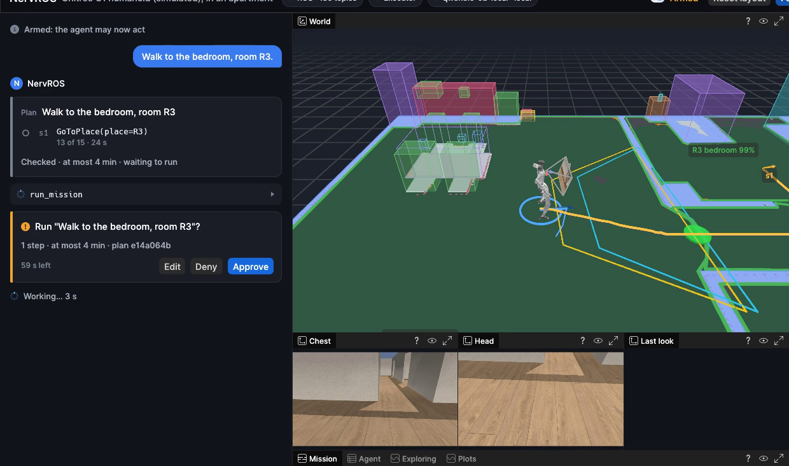
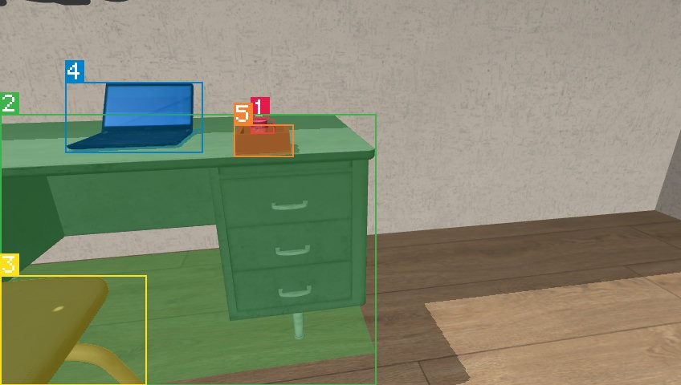
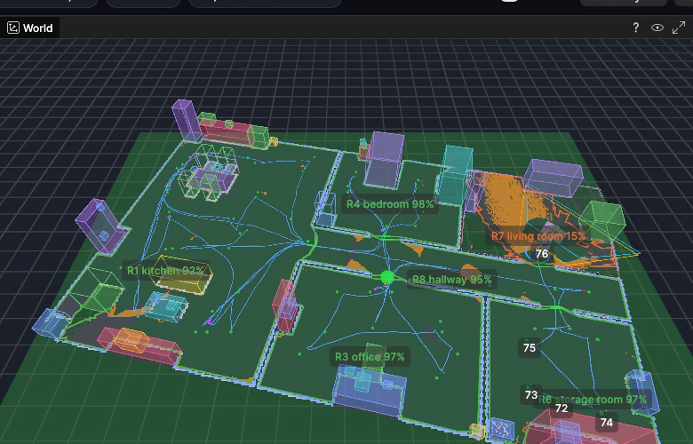
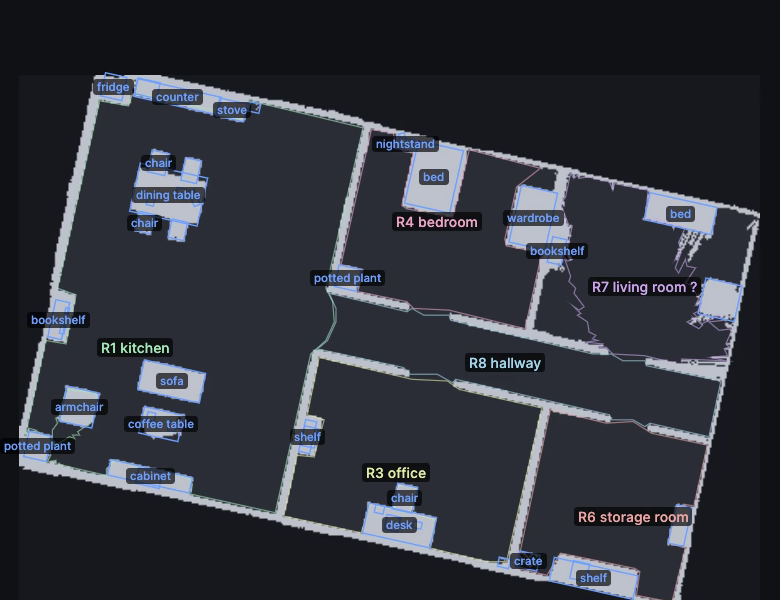

<p align="center">
  
</p>

<p align="center">
  <a href="docs/guide.md"><b>Guide</b></a> ·
  <a href="docs/profile.md">Robot profile</a> ·
  <a href="docs/models.md">Models</a> ·
  <a href="docs/executor.md">Executor contract</a> ·
  <a href="#quick-start">Quick start</a>
</p>

# NervROS

Talk to your ROS 2 robot. NervROS looks through the robot's cameras, keeps track of its world, and
turns what you ask into missions. You check and approve each one before anything moves.

> [!IMPORTANT]
> **Start with the [guide](docs/guide.md).** It shows every feature in a short clip from a real run,
> with the exact words typed and what came back.

https://github.com/user-attachments/assets/0c9381e1-ae1e-4391-a63d-53ef5df6179c

*A simulated Unitree G1 fetches a mug: the plan, the approval, then the walk, the pick and the
place, sped up four times while the robot works.*

NervROS fits any ROS 2 robot through one profile file, and it answers with a local model by
default. It is built and tested in simulation on [grove-g1](https://github.com/Adyansh04/grove-g1),
a Unitree G1 stack on ROS 2 Jazzy. It is in early development.

## What you can do

| You say or do | What NervROS does | Guide |
|---|---|---|
| "What can you see right now?" | Answers from the camera frame, about the numbered marks drawn on it. | [Asking what it sees](docs/guide.md#asking-what-it-sees) |
| "Where is the small white mug?" | Searches the world model: which room, on what, and when it was last seen. | [Asking what it sees](docs/guide.md#asking-what-it-sees) |
| "Point at the tray", "Outline the desk" | Finds things no detector marked. | [Pointing and outlining](docs/guide.md#pointing-and-outlining) |
| "Walk to the bedroom", "Bring the mug to the tray" | Plans with the robot's own skills, checks the plan against your words (left or right, how far, which hand) and waits for your approval. Each step is tracked live. | [Giving it a task](docs/guide.md#giving-it-a-task) |
| "Find a red mug and pick it up" | Runs it as one mission: a step can use what an earlier step found. | [One step's answer in the next](docs/guide.md#one-steps-answer-in-the-next) |
| "Count the chairs in every room" | Writes a short, sandboxed [Rhai](https://rhai.rs) program on the robot's functions. One that moves is approved once and runs as a job, with a live log and a Stop button. | [Counting, looping and measuring](docs/guide.md#counting-looping-and-measuring) |
| "Find my keys" | Ranks where to look, then walks to each place and looks until the detector sees them. | [Finding something](docs/guide.md#finding-something) |
| "Point at the red mug", with no pointing skill | Teaches the robot a new skill from the pieces its executor allows. The skill is kept once its first mission succeeds. | [Teaching it a skill](docs/guide.md#teaching-it-a-skill) |
| "Stop", the Stop button or Ctrl+Shift+S | Halts the robot without waiting for a model. "Pause" holds a mission and "resume" lets it go on. | [Stopping](docs/guide.md#stopping) |
| "Keep the robot out of the kitchen" | Adds a keep-out zone, drawn in red. Plans and navigation goals into it are refused. | [Keeping it out of places](docs/guide.md#keeping-it-out-of-places) |
| "Tell me if the camera drops below 5 Hz" | Runs watches, live plots and schedules in the background. It also reads topics, TF, parameters and logs, as `ros2` does. | [Keeping an eye on it](docs/guide.md#keeping-an-eye-on-it) |
| "Why did that fail?" | A failed mission, a quiet camera or a stopped node opens an incident by itself. NervROS checks the robot's last minutes against playbooks of known faults and names the likely cause and the fix. "Remember this" keeps a new finding as a playbook. | [When something goes wrong](docs/guide.md#when-something-goes-wrong) |
| "Explore the building" | Walks until the camera has seen every room, mapping as it goes. You fix mistakes by chat or in the world editor. | [Mapping a new building](docs/guide.md#mapping-a-new-building) |
| Click, Ctrl+K, or W, A, S and D | Walks to what you click, runs commands, drives by hand, and keeps named places and notes. | [Clicking in the 3D view](docs/guide.md#clicking-in-the-3d-view) |
| `nervros-cli` | The same agent in a terminal: chat, a setup check against the live graph, investigations, single ROS reads, test suites against the robot, and recordings to compare models on without it. | [The command line](docs/guide.md#the-command-line) |

<p align="center">
  
  
</p>

*Left: every mission waits for your approval, with its path drawn in the 3D view. Right: what the
camera sees, with the detector's numbered marks, after the mug went into the tray.*

<p align="center">
  
  
</p>

*Left: a new building mapped room by room, with how much of each room the camera has seen. Right:
the world editor, where you fix a room's type or an object's label by hand.*

## How it works

<p align="center">
  
</p>

1. **You ask**, in the app or in a terminal.
2. **The agent** uses tools: the cameras, the world model, ROS topics, services and actions, its
   memory, and any MCP server you add. It is a Rust core with a local or cloud model.
3. **Anything that moves the robot is a mission.** The agent plans with the robot's own skills,
   NervROS compiles the plan to a behaviour tree, the robot's executor checks it, and you approve
   it.
4. **The executor runs it** and reports each step. The agent then tells you how it went, checked
   against the world model and the camera.

Nothing in NervROS is robot-specific. One [profile](docs/profile.md) names the robot's topics,
services, cameras, skills and limits, and the robot runs missions through a short
[executor contract](docs/executor.md). Models come from llama.cpp, Gemini, OpenRouter or any
OpenAI-compatible server, and each role has its own chain of fallbacks ([models](docs/models.md)).

Also included:

- Sessions you can resume, replay, or keep as a test case.
- A context that condenses itself before it fills up.
- A privacy mode that keeps camera frames on local models.
- A self-description the robot drafts from its own skills and sensors.
- OpenTelemetry spans for each turn, model call, tool call and mission.

## Safe by design

- **Nothing moves until you say so.** The robot starts observe-only. You arm it in the top bar,
  then approve each plan on its card.
- **Plans are checked before you see them.** The robot's executor validates every behaviour tree,
  and NervROS checks the plan against what you asked.
- **Stop always works.** "Stop", the Stop button or Ctrl+Shift+S halts the robot without a model.
  A mission whose window closed or hung stops by itself.
- **Keep-out zones hold.** A plan that ends its walk in a zone, or a navigation goal into one, is
  refused before the robot sees it. Removing a zone always asks you first.
- **The robot's data stays data.** What the cameras, topics and world model report reaches the
  model fenced off as data, never as instructions. Hard deny lists keep every tool away from motor
  and controller topics.

## Quick start

You need Ubuntu 24.04 with ROS 2 Jazzy, Rust through rustup (`rust-toolchain.toml` pins the
version), and these packages:

```bash
sudo apt install ros-dev-tools clang libclang-dev mold pkg-config libssl-dev libxkbcommon-dev \
  libxcb-render0-dev libxcb-shape0-dev libxcb-xfixes0-dev libudev-dev libwayland-dev libvulkan1
```

The local model runs in Docker with the NVIDIA container toolkit and needs about 7 GB of GPU
memory. Fetch it once with the Hugging Face CLI:

```bash
hf download unsloth/Qwen3.5-9B-GGUF Qwen3.5-9B-Q4_K_M.gguf mmproj-F16.gguf
```

Then, from this repository:

```bash
./scripts/local-llm.sh start          # Qwen3.5-9B in llama.cpp on 127.0.0.1:8081
./scripts/build-overlay.sh            # builds nervros_interfaces; again when they change
source scripts/ros-env.sh             # bash; add NERVROS_UDP_ONLY=1 if the graph runs as root
cargo run -p nervros-gui -- --profile profiles/example/nervros.toml
```

The first build compiles the Rerun viewer, which takes about twenty minutes and 30-odd GB of
`target/`. The example profile is a template for your own robot. To run everything in the videos on
the simulated G1, follow grove-g1's
[NervROS guide](https://github.com/Adyansh04/grove-g1/blob/main/docs/guides/nervros.md)
(`./scripts/demos/nervros.sh app`).

Without a window:

```bash
cargo run -p nervros-cli -- --profile profiles/example/nervros.toml chat
cargo run -p nervros-cli -- --profile profiles/example/nervros.toml doctor
cargo run -p nervros-cli -- --profile profiles/example/nervros.toml eval suite.toml --repeat 3
# A model against a scripted robot: no ROS graph, nothing moves (ROS is still sourced to build).
cargo run -p nervros-cli -- --profile scenarios/bench/nervros.toml eval scenarios/bench/suite.toml \
  --robot scenarios/robot/robot.toml --robot scenarios/bench/robot.toml
# The live robot written as a scripted one, and a draft of its self-description.
cargo run -p nervros-cli -- --profile profiles/example/nervros.toml record robot.toml
cargo run -p nervros-cli -- --profile profiles/example/nervros.toml whoami
```

The core needs neither ROS nor the viewer: `cargo build` builds it, and
`cargo test -p nervros-core --test scenarios` runs the scripted scenarios.

## Documentation

- **[Guide](docs/guide.md):** every feature, most with a short clip, and the exact words typed.
- **[Robot profile](docs/profile.md):** fitting NervROS to a robot with one TOML file.
- **[Models](docs/models.md):** local and cloud models, roles, fallbacks and quotas.
- **[Mission executor contract](docs/executor.md):** what the robot side provides, and how a
  mission runs.
